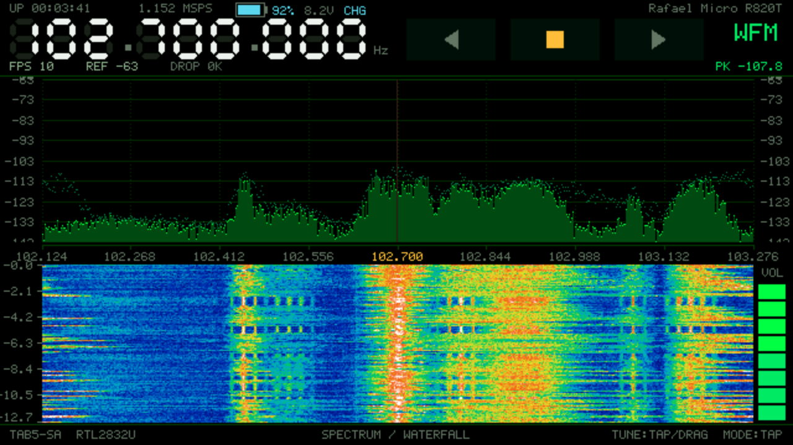

# Tab5SA

A handheld **spectrum analyzer + SDR receiver** running entirely on an
**M5Stack Tab5** (ESP32-P4). Plug an RTL-SDR dongle into the USB-A port and get a
live spectrum, waterfall, touch tuning and demodulated audio — no PC needed.



Forked from [Tab5-SDR](https://github.com/hardparking/Tab5-SDR), largely reworked.

## Specs

| Item | Value |
|---|---|
| Frequency range | 24 MHz – 1766 MHz (R820T) |
| Real-time bandwidth | 1.152 MHz |
| Sample rate | 1.152 MS/s, 8-bit I/Q |
| FFT | 1024 points, Hann window |
| Frequency resolution | ≈ 1.7 kHz (RBW) |
| Spectrum refresh | ≈ 23 fps |
| Waterfall | 128 rows / 45 dB (≈ 5.5 s history) |
| Demodulation | WFM / NFM / AM |
| Audio | 48 kHz, 8-step volume |
| Display | 720×1280, rendered at 640×360 and scaled ×2 |

The dBm scale is nominal, not calibrated — good for comparing signals, not for
absolute level measurement.

## Features

- **Instrument head** — 7-segment frequency readout, dBm graticule, peak hold,
  rainbow waterfall.
- **Touch tuning** — drag to scan, tap to jump, or tap the frequency readout to
  type an exact value on a keypad.
- **AM for airband** — envelope detection with DC tracking. The R820T tunes no
  lower than ~24 MHz, so medium-wave broadcast AM is out of reach; airband
  (118–137 MHz) is the real use case.
- **IMU auto-flip** — the screen turns 180° when the device is flipped, with the
  touch mapping mirrored to match.
- **Battery** — charge enable asserted at boot, INA226 pack monitoring.

## Hardware

- M5Stack Tab5 (ESP32-P4), 720×1280 MIPI-DSI panel.
- RTL-SDR dongle (RTL2832U + R820T) on the **USB-A** port.
- The **internal battery must be connected** — the board browns out on USB power
  alone under the dongle's load.

Two things that cost time if forgotten: the USB-A VBUS is off until the firmware
enables it, and the Tab5 will not charge unless `CHG_EN` on the PI4IOE expander is
driven high (the BSP does both at boot).

## Build & flash

Requires **ESP-IDF v5.5**.

```bash
idf.py set-target esp32p4    # first time only
idf.py build
idf.py -p /dev/ttyACM0 flash monitor
```

On the P4's USB-Serial-JTAG the chip may stay in download mode after flashing. If
the app does not start:

```bash
python -m esptool --port /dev/ttyACM0 --before no_reset --after watchdog_reset run
```

## Architecture

```
RTL-SDR ──USB-A──► librtlsdr ──► IQ ring (PSRAM)
                                    │
  [core 1] iq_proc: demod ──► audio ──► ES8388 speaker
           + FFT ──► spectrum buffer
                                    │
  [core 0] ui ──► 640×360 buffer ──► PPA (×2, rotate) ──► 720×1280 panel
```

| Module | Role |
|---|---|
| `main/sdr.c` | device + async IQ stream; hot-plug supervisor |
| `main/dsp.c` | WFM/NFM/AM demod, FFT spectrum, squelch |
| `main/audio.c` | ES8388 output via esp_codec_dev |
| `main/ui.c` | rendering, gestures, keypad |
| `components/bsp/` | board support: panel, touch, audio, USB power, IMU, battery |
| `components/librtlsdr/` | librtlsdr on the ESP-IDF USB host stack |

The firmware tolerates a missing dongle — the USB port is shared with the
flashing link, so the UI reports `NO RTL-SDR` instead of freezing.

`tools/uistub/` renders the real `ui.c` on the host so layout can be iterated
without a flash cycle.

`tools/shot.py` captures the live panel over USB-C (`S` on the serial port →
720x1280 RGB565 frame, saved as PNG). No extra wiring.

## Credits & license

**GPL-2.0-or-later** (see [LICENSE](LICENSE)), as required by librtlsdr.

- [librtlsdr](https://github.com/steve-m/librtlsdr) — Steve Markgraf et al.
  The USB-host port derives from [XTR1984/xtrsdr](https://github.com/XTR1984/xtrsdr).
- Board support derives from [Tab5-HID-Device](https://github.com/hardparking/Tab5-HID-Device)
  by Hiroki Kawakami (MIT).
- BMI270 config blob — Bosch Sensortec (BSD-3-Clause).
- esp-dsp, esp_codec_dev and the LCD/touch drivers — Espressif (Apache-2.0).
